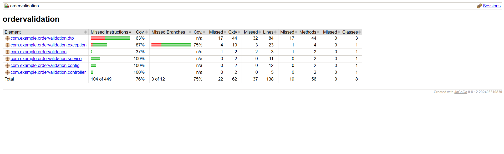
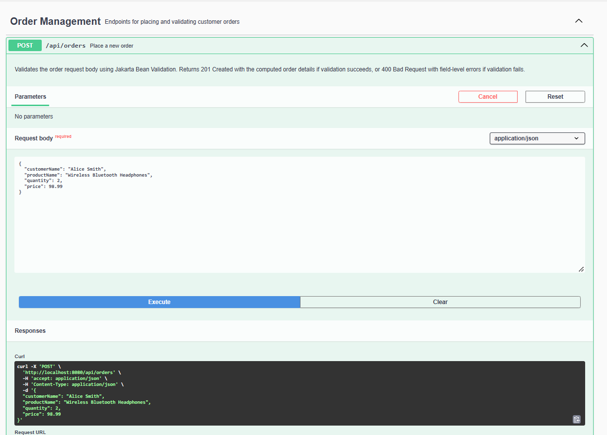
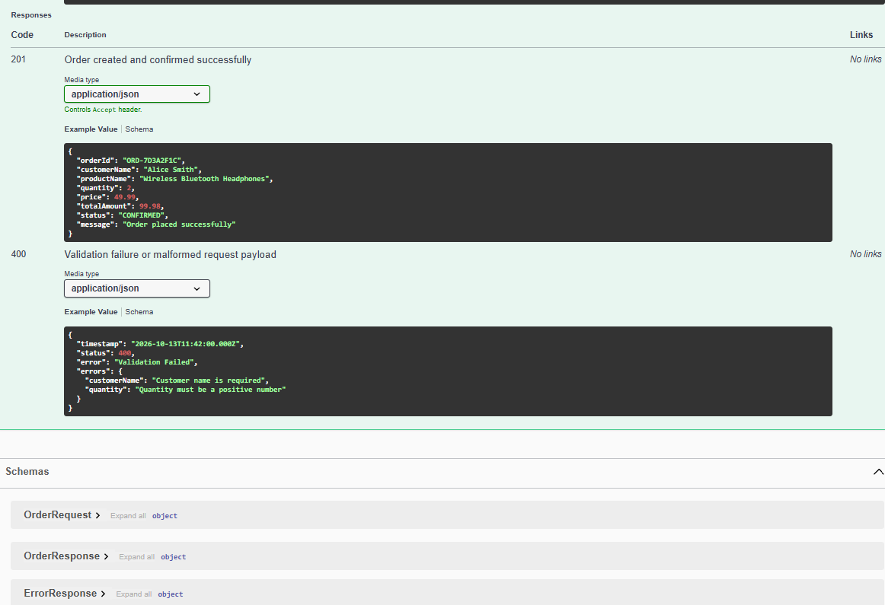

# Online Shopping Order Service - Request Validation API


A robust Spring Boot REST API that validates online shopping order requests using Jakarta Bean Validation. It demonstrates defense-in-depth request validation, centralized error handling via `@RestControllerAdvice`, interactive API documentation through Swagger UI, and complete unit/integration test coverage with MockMvc.

---

## 🛠️ Tech Stack

- **Language**: Java 17
- **Framework**: Spring Boot 3.4.3
- **Build Tool**: Maven (with included Maven Wrapper `mvnw` / `mvn.cmd`)
- **Validation**: Spring Validation (Hibernate Validator / Jakarta Bean Validation)
- **API Documentation**: springdoc-openapi 2.8.9 (Swagger UI)
- **Code Coverage**: JaCoCo Maven Plugin 0.8.12
- **Testing**: JUnit 5, MockMvc, AssertJ

---

## ✨ Features

- **Field-Level Request Validation**: Strictly enforces constraints on incoming DTO fields (`@NotBlank`, `@NotNull`, `@Positive`) before any business processing occurs.
- **Structured Error Responses**: Centralized `@RestControllerAdvice` interceptor converts validation failures into uniform, developer-friendly HTTP `400 Bad Request` responses mapping each invalid field to its error message.
- **Malformed Request Handling**: Catches invalid JSON syntax and type mismatches (via `HttpMessageNotReadableException`) with clean error explanations.
- **Interactive Swagger UI**: Full OpenAPI 3 specification and interactive dashboard at `/swagger-ui.html` with pre-configured schemas and examples.
- **Comprehensive MockMvc Test Suite**: 19 automated tests covering valid submissions, missing fields, whitespace-only inputs, boundary values (zero/negative numbers, maximum quantities), and multi-field validation failures.
- **Continuous Integration**: Automated GitHub Actions CI workflow executing test suites and coverage verification on every push and pull request.

---

## 📁 Project Structure

```text
com.example.ordervalidation
├── OrderValidationApplication.java      # Application bootstrap
├── config/
│   └── OpenApiConfig.java               # OpenAPI & Swagger UI specification configuration
├── controller/
│   └── OrderController.java             # REST controller exposing POST /api/orders
├── dto/
│   ├── OrderRequest.java                # Validated incoming payload with constraint annotations
│   ├── OrderResponse.java               # Confirmed order response with generated ID & computed total
│   └── ErrorResponse.java               # Unified schema for 400 Bad Request responses
├── exception/
│   └── GlobalExceptionHandler.java      # @RestControllerAdvice for validation & JSON parsing errors
└── service/
    └── OrderService.java                # Business logic, total amount calculation, and order generation
```

---

## 🚀 Getting Started

### Prerequisites
- Java 17+ installed (`java -version`)
- Maven 3.8+ (or use the included `mvnw` wrapper)

### How to Run
Clone or navigate to the project directory and run:

```bash
mvn spring-boot:run
```

*(On Windows using the wrapper)*:
```powershell
.\mvn.cmd spring-boot:run
```

The service will start on port `8080`:
```text
Tomcat started on port 8080 (http) with context path '/'
Started OrderValidationApplication in ~2.5 seconds
```

### Interactive API Documentation
Once running, open your browser to access the Swagger UI:
👉 **[http://localhost:8080/swagger-ui.html](http://localhost:8080/swagger-ui.html)**

OpenAPI v3 raw JSON specification:
👉 **[http://localhost:8080/v3/api-docs](http://localhost:8080/v3/api-docs)**

---

## 📖 API Reference

### `POST /api/orders`
Creates and validates a new customer purchase order.

#### Validation Rules Matrix

| Field | Type | Validation Rule | Error Message |
| :--- | :--- | :--- | :--- |
| `customerName` | `String` | `@NotBlank` | `"Customer name is required"` |
| `productName` | `String` | `@NotBlank` | `"Product name is required"` |
| `quantity` | `Integer` | `@NotNull`, `@Positive` | `"Quantity must be a positive number"` |
| `price` | `Double` | `@NotNull`, `@Positive` | `"Price must be greater than zero"` |

---

### Sample Requests & Responses

#### 🟢 1. Valid Request (`201 Created`)

**Request Payload**:
```json
{
  "customerName": "Alice Smith",
  "productName": "Wireless Noise Canceling Headphones",
  "quantity": 2,
  "price": 49.99
}
```

**Response Body (`201 Created`)**:
```json
{
  "orderId": "ORD-7D3A2F1C",
  "customerName": "Alice Smith",
  "productName": "Wireless Noise Canceling Headphones",
  "quantity": 2,
  "price": 49.99,
  "totalAmount": 99.98,
  "status": "CONFIRMED",
  "message": "Order placed successfully"
}
```

---

#### 🔴 2. Invalid Request (`400 Bad Request`)

**Request Payload** (contains blank customer, missing product, zero quantity, negative price):
```json
{
  "customerName": "   ",
  "productName": "",
  "quantity": 0,
  "price": -19.99
}
```

**Response Body (`400 Bad Request`)**:
```json
{
  "timestamp": "2026-10-14T01:52:00.000Z",
  "status": 400,
  "error": "Validation Failed",
  "errors": {
    "customerName": "Customer name is required",
    "productName": "Product name is required",
    "quantity": "Quantity must be a positive number",
    "price": "Price must be greater than zero"
  }
}
```

---

## 🧪 Testing

The test suite consists of **19 comprehensive MockMvc automated tests** located in `OrderControllerTest`. They validate end-to-end request handling, constraint enforcement, and error payload formatting across all key scenarios:

- **Valid Input**: Standard valid requests (201 Created), minimal boundary amounts (`quantity = 1, price = 0.01`), and high-volume quantities (`quantity = 1,000,000`).
- **Boundary Values**: Zero values (`quantity = 0`, `price = 0`) and negative values (`quantity = -3`, `price = -199.99`).
- **Missing & Blank Fields**: Blank customer name (`"   "`), missing product name, missing quantity, missing price, and empty JSON object (`{}`) triggering all 4 validation errors simultaneously.
- **Malformed JSON & Type Mismatches**: Unparseable JSON bodies (missing closing braces), type mismatches (string `"two"` provided for integer quantity), and missing request body entirely.

### Running the Tests
To execute all tests:
```bash
mvn test
```

*(On Windows using wrapper)*:
```powershell
.\mvn.cmd test
```

To run tests and generate the full JaCoCo code coverage report:
```powershell
.\mvnw.cmd verify
```
*(On Linux/macOS: `./mvnw verify`)*

The generated JaCoCo HTML report is available at:
👉 `target/site/jacoco/index.html`

---

## 📊 Coverage

Code coverage is generated by the `jacoco-maven-plugin` during the verify phase:

```bash
.\mvnw.cmd verify
```

The report covers controller, service, configuration, DTO, and exception handling components.



*(Coverage report screenshot referenced at [`docs/coverage.png`](docs/coverage.png))*

---

## 📸 Screenshots

| Swagger UI - Successful Order (201) | Swagger UI - Validation Failure (400) |
| :---: | :---: |
|  |  |

*(Screenshots can be viewed in the [`docs/`](docs/) folder)*

---

## 👤 Author

**Yasasri Amara**  
- **GitHub**: [github.com/yasasri-amara](https://github.com/yasasri-amara)
